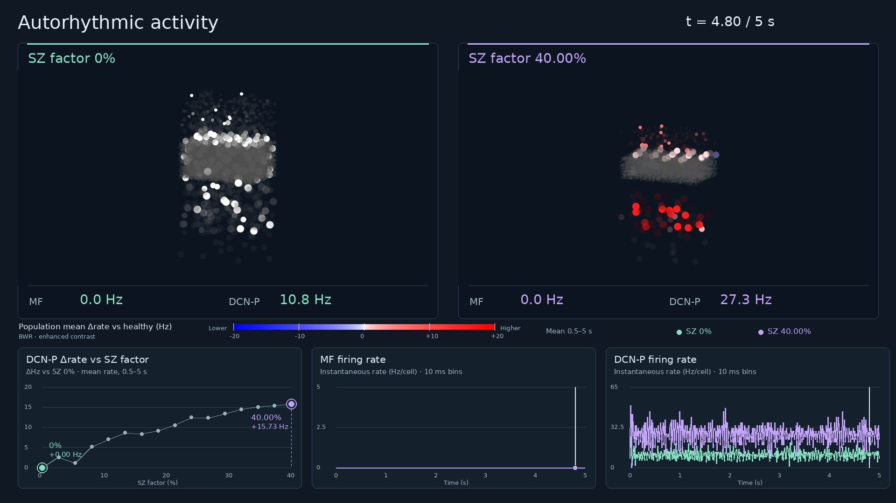
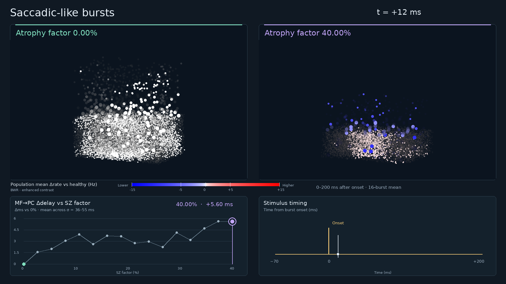
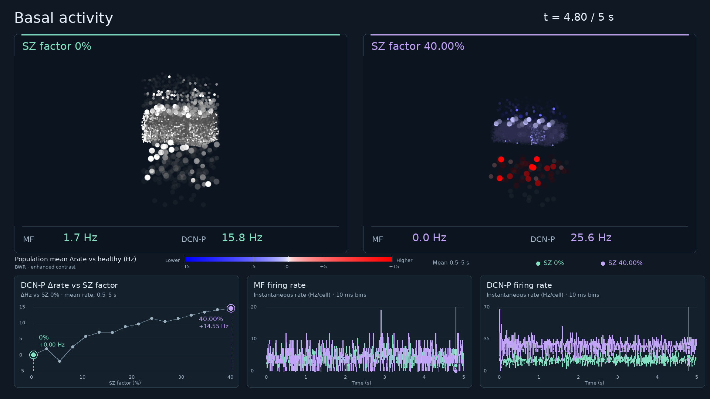
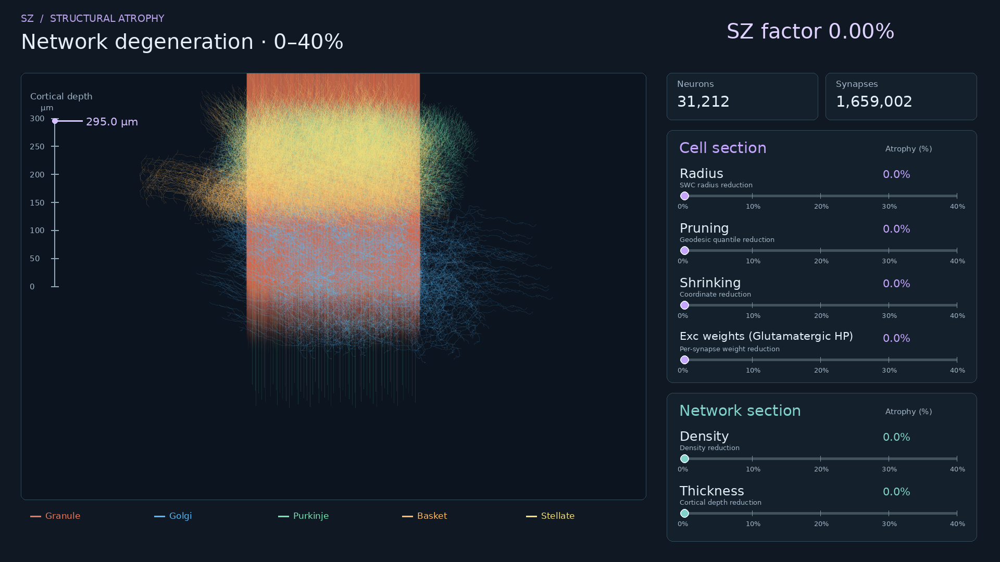

# Original-paper activity and structural videos

These movies visualize the **original paper's HDF5 networks and, for activity replays, recorded NIO spikes** from the [Zenodo reproducibility dataset](https://doi.org/10.5281/zenodo.23391996). They do not use the later BSB 8 / Cerebellum Designer simulations. No new simulations were run for these movies.

| Movie | Duration | View |
| --- | ---: | --- |
| [Autorhythmic activity](autoritmo_sz_factor_dcnp.mp4) | 40.04 s | Healthy reference vs SZ factor 0–40%; MF and DCN-P rates; DCN-P Δrate curve |
| [Basal activity](basal_sz_factor_dcnp.mp4) | 40.04 s | MF background 4 Hz; healthy vs SZ 0–40%; DCN-P Δrate curve |
| [Structural atrophy](atrofia_senza_resilienza_rotante_100.mp4) | 34.00 s | Rotating paper morphologies; cortical depth, counts and parameter reductions |
| [Saccadic-like bursts / Kase](kase_sz_factor_delay.mp4) | 58.24 s | Healthy reference vs SZ factor 0–40%; MF→PC Δdelay curve; stimulus-onset timing |

All four are 1920 × 1080, H.264, 25 fps, with English labels. Open a movie link to preview or download the MP4.

## Captions

**Autorhythmic activity.** Original paper recordings with zero mossy-fiber input. The healthy network remains on the left while the right-hand network advances through the 16 archived SZ levels, without resilience. Both sides replay the same absolute simulation time, from 0 to 5 s, at 0.125× speed. The lower-left curve shows the change in mean DCN-P firing rate relative to SZ 0%, calculated over 0.5–5 s and including silent cells. Its highlighted point identifies the displayed right-hand network. MF and DCN-P traces/readouts use recorded spike counts in 10 ms bins; the readout shows the last completed bin. The colour scale is ±20 Hz.

**Saccadic-like bursts.** Original paper Kase recordings, with the healthy reference on the left and the same 16 SZ levels on the right. Each pair replays the first burst from −70 to +200 ms relative to the recorded onset at 1000 ms, at 0.075× speed. The highlighted point follows the displayed network on the MF→PC Δdelay curve. Delay is the paper-analysis cross-correlation lag relative to SZ 0%, averaged across the 20 triangular-kernel settings σ = 36–55 ms, using a 0.1 ms time step and the top quartile of cells ranked by their 99th-percentile firing rate separately for MF and PC. The timing panel marks onset only; its flat line is not an input-rate trace. Population colours represent the mean Δrate across all 16 recorded 0–200 ms post-onset windows, using a ±15 Hz scale.

**Basal activity.** The original paper's 4 Hz Poisson mossy-fiber background, replayed over 0–5 s at 0.125× speed. The healthy reference stays on the left; the right advances through the 16 SZ levels without resilience. The highlighted DCN-P Δrate point uses the mean over 0.5–5 s, including silent cells. MF and DCN-P traces use 10 ms bins and readouts show the last completed bin. Population colours show mean differences from healthy on a ±15 Hz scale. The original stochastic input realizations are preserved and are not assumed to be identical across conditions.

**Structural atrophy.** A 360° rotation through the 16 original paper networks, without resilience, from nominal SZ factor 0 to 40%. The movie displays 100% of the stored Granule, Golgi, Purkinje, Basket and Stellate morphologies, with population colours and a fixed spatial scale. Soma segments and subcortical dots are hidden. Cortical depth is measured from the archived layer configuration and decreases from 295.0 to 179.312342 µm. The neuron and synapse counters refer to the full archived network, including populations outside the five visible cortical types. Cell and network sliders show the recorded radius, pruning, shrinking, density and thickness reductions. “Exc weights (Glutamatergic HP)” represents the range of nominal **per-synapse** excitatory-weight reductions across the 14 excitatory pathways, not total network weight or glutamate concentration. Radius/shrinking/pruning are algorithm controls: pruning is a geodesic-distance quantile reduction, not the percentage of branches removed. The video shows stored network states rather than newly reconstructed or interpolated geometries.

## Interpretation

- These are montages of separately recorded conditions, not a simulation in which atrophy develops during the run. In the activity videos, the healthy network and shared spatial scale remain fixed; each pair is synchronized to the same original time. The structural video rotates one network at a time at a fixed spatial scale.
- The displayed SZ/atrophy factor is the nominal paper grid, **not the percentage of neurons removed**. Stored scaling factors are rounded to three decimals; the mapping is preserved in the curve tables.
- In the activity videos, all recorded cells/relay points are drawn at their stored positions. Flashes use original per-cell events in 5 ms visual bins with a 30 ms optical afterglow. Brightness is not membrane voltage, a reconstructed action potential, or a propagation-path measurement.
- In the activity videos, white is the healthy reference. Blue/red mean a lower/higher **population-average** firing rate relative to the corresponding healthy population, including silent cells. A symmetric square-root colour mapping enhances contrast. There is no verified one-to-one cell pairing between networks. The activity colour scales are labelled explicitly and do not clip observed values. Structural colours identify populations.
- The original paper uses native static synapses. These movies are not a TM-versus-static comparison.
- **Archived Kase burst amplitudes and durations differ between SZ conditions.** They have been preserved, not replaced with matched inputs. The Kase comparison therefore does not isolate an atrophy-only effect. The kernel settings are analysis choices, not independent biological replicates; the estimated MF→PC lag is not a direct monosynaptic delay.

## Sources and validation

| Protocol | Zenodo archive | Original series |
| --- | --- | --- |
| Autorhythmic | `01_AUTOR.zip` | `20251120172014_basal_activity_2_0_glutamate_all` |
| Basal and structural | `02_BASAL.zip` | `20251004180523_basal_activity_2_0_glutamate_all` |
| Kase | `03_EVOKED_A.zip` | `20251113161643_kase_stim_vitro_2_0_glutamate_all` |

All 48 activity conditions were re-extracted in read-only mode from the recovered archives: population counts, numeric chunk order, NEST sender ranges, disjoint MPI sender sets, complete recorders and binned spike counts were checked. Autorhythmic MF spikes are zero at every level. All four encoded movies were fully decoded to verify frame count and duration.

The Kase and basal MP4s reuse their previously rendered final versions. For all 16 levels of each protocol, their source exports were verified to have exactly the same geometry, population counts, radii, chunk order, event bitsets, rates and stimulus schedules as the newly extracted data. Raw NIO and YAML file hashes also match. Some recovered **HDF5 container hashes differ** from the former working copies; equality of other, unused HDF5 content is not claimed. The structural exports were also re-extracted: all stored morphology points, radii, parent topology, placements, rotations and assignments match the previous render inputs exactly. Archived layer dimensions, morphometric controls, counts and all 14 excitatory weight ratios were verified. Both hashes and the exact comparison scope are recorded in `provenance.json`.

- `provenance.json`: relative archive paths, input SHA-256 hashes, verified comparison scope and movie methods.
- `validation.json`: encoded-video and data validation results.
- `*_curve.csv`: the exact values displayed in the lower-left graphs.
- `kase_sz_factor_delay_sigma_lags.csv`: individual lag estimates for the kernel settings.
- `*_population_delta_rates.csv`: population means, differences and colours.
- `structural_parameters.csv`: the exact reductions, counts and depth shown in the structural movie.
- `paper_structural_features.csv`: supplementary counts and nominal excitatory-weight sums; the total weight sum is not the per-synapse quantity shown by the slider.
- `SHA256SUMS`: checksums of all distributed files; run `sha256sum -c SHA256SUMS` from this folder.

The full source archives remain on Zenodo rather than being duplicated in Git. The extraction, rendering and validation working files are retained with the local video release on the project HD.

## Citation

Vergani, A. A., Faris, P., De Grazia, M., Fusar-Poli, P., Casellato, C., & D'Angelo, E. U. (2026). *Cerebellar Degeneration Induces Timeliness Disruption, Paradoxical Information Flow and Network Overdrive in a Digital Model of Schizophrenia*. [Scientific preprint](https://doi.org/10.5281/zenodo.18813588). Please also cite the [reproducibility dataset](https://doi.org/10.5281/zenodo.23391996) when using these archived outputs.
